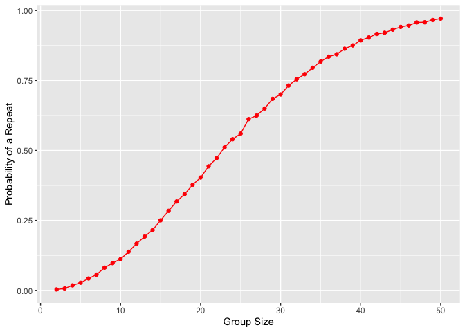
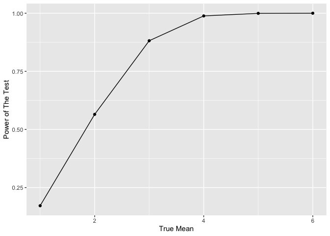

p8105_hw5_ryd2106
================
Risa Dickerman
2026-11-17

``` r
library(tidyverse)
```

    ## ── Attaching core tidyverse packages ──────────────────────── tidyverse 2.0.0 ──
    ## ✔ dplyr     1.2.1     ✔ readr     2.2.0
    ## ✔ forcats   1.0.1     ✔ stringr   1.6.0
    ## ✔ ggplot2   4.0.3     ✔ tibble    3.3.1
    ## ✔ lubridate 1.9.5     ✔ tidyr     1.3.2
    ## ✔ purrr     1.2.2     
    ## ── Conflicts ────────────────────────────────────────── tidyverse_conflicts() ──
    ## ✖ dplyr::filter() masks stats::filter()
    ## ✖ dplyr::lag()    masks stats::lag()
    ## ℹ Use the conflicted package (<http://conflicted.r-lib.org/>) to force all conflicts to become errors

``` r
library(patchwork)
```

## Problem 1

``` r
repeated_birthdays = function(n=20) {
  birthdays = sample(1:365, size = n, replace = TRUE)
  birthdays_repeated = length(unique(birthdays)) < n
birthdays_repeated
}
```

``` r
birthday_results_df = 
  expand_grid(
    number_of_people = 2:50,
    iter = 1:10000
  ) |> 
  mutate(
    repeated = map_lgl(.x=number_of_people, ~repeated_birthdays(.x))
  )
```

``` r
birthday_results_df |> 
  group_by(number_of_people) |> 
  summarize(prob_of_repeat = mean(repeated)) |> 
  ggplot(aes(x = number_of_people, y = prob_of_repeat)) +
  geom_point( color = "red") +
  geom_line( color = "red") +
  labs( x = "Group Size") +
  labs( y = "Probability of a Repeat")
```

<!-- -->
These results indicate that as the group size increases the probability
of having two members with the same birthday increases. At first this
follows a steep increase until around a group of 15, at this point it
becomes a steady rise. At a group size of 35 this increase starts
leveling off. While not reaching 1, the probability does get close.

## Problem 2

``` r
patient_files =
  tibble(
    files = list.files(path = "./data"),
  ) |> 
  mutate(
    files = str_c("./data/",files)
    ) |> 
  mutate(
  readings_per_week = map(files, read_csv) 
  )|> 
  mutate(
    files = str_remove(files, "./data/"),
    files = str_remove(files, ".csv")
  ) |> 
  rename(arm_subject  = files) |> 
  separate(
    arm_subject, 
    into =c("arm", "subject_id"), 
            sep = "_") |> 
  select(c(arm, subject_id, readings_per_week))
```

    ## Rows: 1 Columns: 8
    ## ── Column specification ────────────────────────────────────────────────────────
    ## Delimiter: ","
    ## dbl (8): week_1, week_2, week_3, week_4, week_5, week_6, week_7, week_8
    ## 
    ## ℹ Use `spec()` to retrieve the full column specification for this data.
    ## ℹ Specify the column types or set `show_col_types = FALSE` to quiet this message.
    ## Rows: 1 Columns: 8
    ## ── Column specification ────────────────────────────────────────────────────────
    ## Delimiter: ","
    ## dbl (8): week_1, week_2, week_3, week_4, week_5, week_6, week_7, week_8
    ## 
    ## ℹ Use `spec()` to retrieve the full column specification for this data.
    ## ℹ Specify the column types or set `show_col_types = FALSE` to quiet this message.
    ## Rows: 1 Columns: 8
    ## ── Column specification ────────────────────────────────────────────────────────
    ## Delimiter: ","
    ## dbl (8): week_1, week_2, week_3, week_4, week_5, week_6, week_7, week_8
    ## 
    ## ℹ Use `spec()` to retrieve the full column specification for this data.
    ## ℹ Specify the column types or set `show_col_types = FALSE` to quiet this message.
    ## Rows: 1 Columns: 8
    ## ── Column specification ────────────────────────────────────────────────────────
    ## Delimiter: ","
    ## dbl (8): week_1, week_2, week_3, week_4, week_5, week_6, week_7, week_8
    ## 
    ## ℹ Use `spec()` to retrieve the full column specification for this data.
    ## ℹ Specify the column types or set `show_col_types = FALSE` to quiet this message.
    ## Rows: 1 Columns: 8
    ## ── Column specification ────────────────────────────────────────────────────────
    ## Delimiter: ","
    ## dbl (8): week_1, week_2, week_3, week_4, week_5, week_6, week_7, week_8
    ## 
    ## ℹ Use `spec()` to retrieve the full column specification for this data.
    ## ℹ Specify the column types or set `show_col_types = FALSE` to quiet this message.
    ## Rows: 1 Columns: 8
    ## ── Column specification ────────────────────────────────────────────────────────
    ## Delimiter: ","
    ## dbl (8): week_1, week_2, week_3, week_4, week_5, week_6, week_7, week_8
    ## 
    ## ℹ Use `spec()` to retrieve the full column specification for this data.
    ## ℹ Specify the column types or set `show_col_types = FALSE` to quiet this message.
    ## Rows: 1 Columns: 8
    ## ── Column specification ────────────────────────────────────────────────────────
    ## Delimiter: ","
    ## dbl (8): week_1, week_2, week_3, week_4, week_5, week_6, week_7, week_8
    ## 
    ## ℹ Use `spec()` to retrieve the full column specification for this data.
    ## ℹ Specify the column types or set `show_col_types = FALSE` to quiet this message.
    ## Rows: 1 Columns: 8
    ## ── Column specification ────────────────────────────────────────────────────────
    ## Delimiter: ","
    ## dbl (8): week_1, week_2, week_3, week_4, week_5, week_6, week_7, week_8
    ## 
    ## ℹ Use `spec()` to retrieve the full column specification for this data.
    ## ℹ Specify the column types or set `show_col_types = FALSE` to quiet this message.
    ## Rows: 1 Columns: 8
    ## ── Column specification ────────────────────────────────────────────────────────
    ## Delimiter: ","
    ## dbl (8): week_1, week_2, week_3, week_4, week_5, week_6, week_7, week_8
    ## 
    ## ℹ Use `spec()` to retrieve the full column specification for this data.
    ## ℹ Specify the column types or set `show_col_types = FALSE` to quiet this message.
    ## Rows: 1 Columns: 8
    ## ── Column specification ────────────────────────────────────────────────────────
    ## Delimiter: ","
    ## dbl (8): week_1, week_2, week_3, week_4, week_5, week_6, week_7, week_8
    ## 
    ## ℹ Use `spec()` to retrieve the full column specification for this data.
    ## ℹ Specify the column types or set `show_col_types = FALSE` to quiet this message.
    ## Rows: 1 Columns: 8
    ## ── Column specification ────────────────────────────────────────────────────────
    ## Delimiter: ","
    ## dbl (8): week_1, week_2, week_3, week_4, week_5, week_6, week_7, week_8
    ## 
    ## ℹ Use `spec()` to retrieve the full column specification for this data.
    ## ℹ Specify the column types or set `show_col_types = FALSE` to quiet this message.
    ## Rows: 1 Columns: 8
    ## ── Column specification ────────────────────────────────────────────────────────
    ## Delimiter: ","
    ## dbl (8): week_1, week_2, week_3, week_4, week_5, week_6, week_7, week_8
    ## 
    ## ℹ Use `spec()` to retrieve the full column specification for this data.
    ## ℹ Specify the column types or set `show_col_types = FALSE` to quiet this message.
    ## Rows: 1 Columns: 8
    ## ── Column specification ────────────────────────────────────────────────────────
    ## Delimiter: ","
    ## dbl (8): week_1, week_2, week_3, week_4, week_5, week_6, week_7, week_8
    ## 
    ## ℹ Use `spec()` to retrieve the full column specification for this data.
    ## ℹ Specify the column types or set `show_col_types = FALSE` to quiet this message.
    ## Rows: 1 Columns: 8
    ## ── Column specification ────────────────────────────────────────────────────────
    ## Delimiter: ","
    ## dbl (8): week_1, week_2, week_3, week_4, week_5, week_6, week_7, week_8
    ## 
    ## ℹ Use `spec()` to retrieve the full column specification for this data.
    ## ℹ Specify the column types or set `show_col_types = FALSE` to quiet this message.
    ## Rows: 1 Columns: 8
    ## ── Column specification ────────────────────────────────────────────────────────
    ## Delimiter: ","
    ## dbl (8): week_1, week_2, week_3, week_4, week_5, week_6, week_7, week_8
    ## 
    ## ℹ Use `spec()` to retrieve the full column specification for this data.
    ## ℹ Specify the column types or set `show_col_types = FALSE` to quiet this message.
    ## Rows: 1 Columns: 8
    ## ── Column specification ────────────────────────────────────────────────────────
    ## Delimiter: ","
    ## dbl (8): week_1, week_2, week_3, week_4, week_5, week_6, week_7, week_8
    ## 
    ## ℹ Use `spec()` to retrieve the full column specification for this data.
    ## ℹ Specify the column types or set `show_col_types = FALSE` to quiet this message.
    ## Rows: 1 Columns: 8
    ## ── Column specification ────────────────────────────────────────────────────────
    ## Delimiter: ","
    ## dbl (8): week_1, week_2, week_3, week_4, week_5, week_6, week_7, week_8
    ## 
    ## ℹ Use `spec()` to retrieve the full column specification for this data.
    ## ℹ Specify the column types or set `show_col_types = FALSE` to quiet this message.
    ## Rows: 1 Columns: 8
    ## ── Column specification ────────────────────────────────────────────────────────
    ## Delimiter: ","
    ## dbl (8): week_1, week_2, week_3, week_4, week_5, week_6, week_7, week_8
    ## 
    ## ℹ Use `spec()` to retrieve the full column specification for this data.
    ## ℹ Specify the column types or set `show_col_types = FALSE` to quiet this message.
    ## Rows: 1 Columns: 8
    ## ── Column specification ────────────────────────────────────────────────────────
    ## Delimiter: ","
    ## dbl (8): week_1, week_2, week_3, week_4, week_5, week_6, week_7, week_8
    ## 
    ## ℹ Use `spec()` to retrieve the full column specification for this data.
    ## ℹ Specify the column types or set `show_col_types = FALSE` to quiet this message.
    ## Rows: 1 Columns: 8
    ## ── Column specification ────────────────────────────────────────────────────────
    ## Delimiter: ","
    ## dbl (8): week_1, week_2, week_3, week_4, week_5, week_6, week_7, week_8
    ## 
    ## ℹ Use `spec()` to retrieve the full column specification for this data.
    ## ℹ Specify the column types or set `show_col_types = FALSE` to quiet this message.

``` r
files_unest = 
  patient_files |> 
  unnest() |> 
  pivot_longer(cols = starts_with("week"),
    names_to = "week",
    values_to = "measurements"
  )
```

    ## Warning: `cols` is now required when using `unnest()`.
    ## ℹ Please use `cols = c(readings_per_week)`.

``` r
sphaget_plot =
  files_unest |> 
  mutate(
    week = str_replace(week, "week_", ""),
    arm = case_match(
      arm,
      "con" ~ "control",
      "exp" ~ "experiment")
    )|> 
  ggplot(aes(x=week, y = measurements))  +
  geom_line(
    mapping = aes(group = subject_id, color = subject_id)) +
  facet_grid(~arm) +
  labs( x = "Week") +
  labs(y = "Measurements")
```

    ## Warning: There was 1 warning in `mutate()`.
    ## ℹ In argument: `arm = case_match(arm, "con" ~ "control", "exp" ~
    ##   "experiment")`.
    ## Caused by warning:
    ## ! `case_match()` was deprecated in dplyr 1.2.0.
    ## ℹ Please use `recode_values()` instead.

``` r
sphaget_plot
```

<!-- -->

The data shows that while the control arm shows no marked improvement
over time, the experiment arm is showing gradual increases in the
measurement over the time period.

## Problem 3

``` r
#Initial variables
n = 30
sd = 5
mu = 0


alpha = 0.05
conf_level = 1-alpha
#Ho
mu_o = 0

#removing randomness
set.seed(5)
```

``` r
norm_mu_sd = function(n = 30, mu = 0, sd = 5) {
  
  data = tibble(
    x = rnorm(n,mu,sd)
  )

list =
  data |> 
  summarize(
    mu_hat = mean(x),
    obs = list(x)
  )
list
}
```

``` r
samples = 5000

t_test_rep = function(samples=5000, n=30, mu=0) {
  rep_norm_mu = 
  expand_grid(
    n=30,
    iter = 1:samples
  ) |> 
  mutate(
    estimates = map(n, ~norm_mu_sd(n=.x, mu=mu))
  ) |> 
  bind_rows() |> 
  unnest(estimates) 

  t_tests = 
  rep_norm_mu |> 
  mutate(
    t_tests = map(.x=obs, ~t.test(.x, mu=mu_o, conf.level = conf_level))
    ) |> 
  mutate(
    t_tests = map(t_tests, broom::tidy)
  ) |> 
  unnest(t_tests)

t_tests
}
```

``` r
mus = c(1,2,3,4,5,6)

mu_delta_2 =
  map(.x=mus, ~t_test_rep(mu=.x) |> 
        mutate(mu= .x)) |> 
  bind_rows() |> 
  janitor::clean_names()
```

``` r
power_plot =
  mu_delta_2 |> 
  group_by(mu) |> 
  summarize(
    power = mean(as.numeric(p_value) < alpha)
  ) |> 
  ggplot(aes(x = mu, y = power)) +
  geom_point() +
  geom_line() +
  labs(x = "True Mean",
       y = "Power of The Test")
power_plot
```

<!-- --> As the
size of the effect increases (as the true value of the mean varries more
from the null hypothesis) the power of the test increases. As the true
mean reaches 4 the power start to level out at a probability of 1 and
continues for all further values.

``` r
muhat_vs_mu_p = 
  mu_delta_2 |> 
  group_by(mu) |> 
  mutate(
    mu_hat_rej = if_else(p_value < alpha, mu_hat, NA),
    mean_mu_hat_rej = mean( mu_hat_rej, na.rm = TRUE),
    mean_mu_hat = mean(mu_hat)
  ) |> 
  ggplot(aes(x = mu)) +
  geom_point(aes(y = mean_mu_hat, color = "Across All Samples")) +
  geom_line(aes(y = mean_mu_hat, color = "Across All Samples")) +
  geom_point(aes(y = mean_mu_hat_rej, color = "Across Rejected Nulls")) +
  geom_line(aes(y = mean_mu_hat_rej, color = "Across Rejected Nulls")) +
  labs(x = "True Mean") +
  labs(y = "Observed Means") 
  
muhat_vs_mu_p
```

<!-- -->

The sample average of the observed mean across all tests for which the
null was rejected does not at first line up with the true mean. However
as the mean increases, this approximation closer aligns and matches the
true mean. This is because at a lower true mean, there are less
rejections, with only extreme points being assessed. However as the true
mean diverges more from the null mean (0), the higher number of rejected
value brings a more averaged evaluation from the datapoints as to where
the true mean lies.
